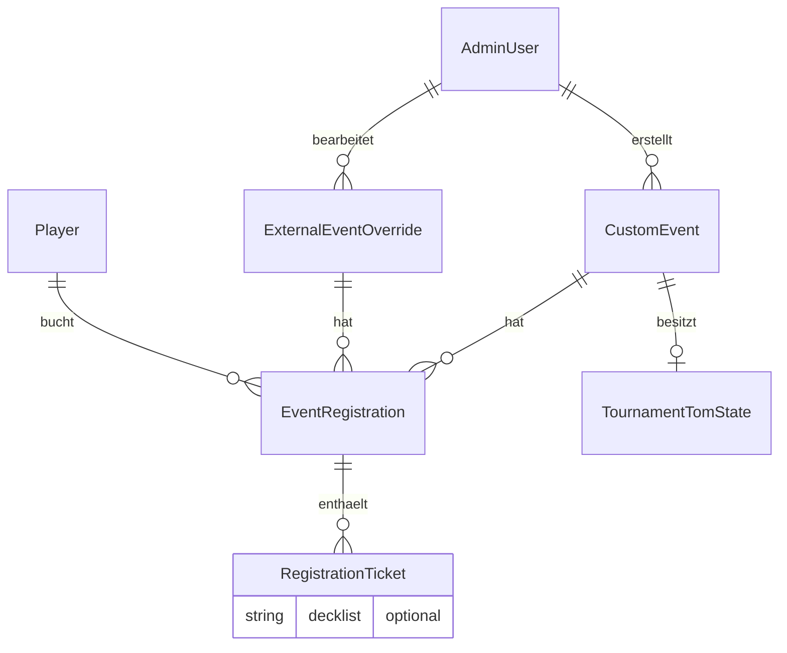
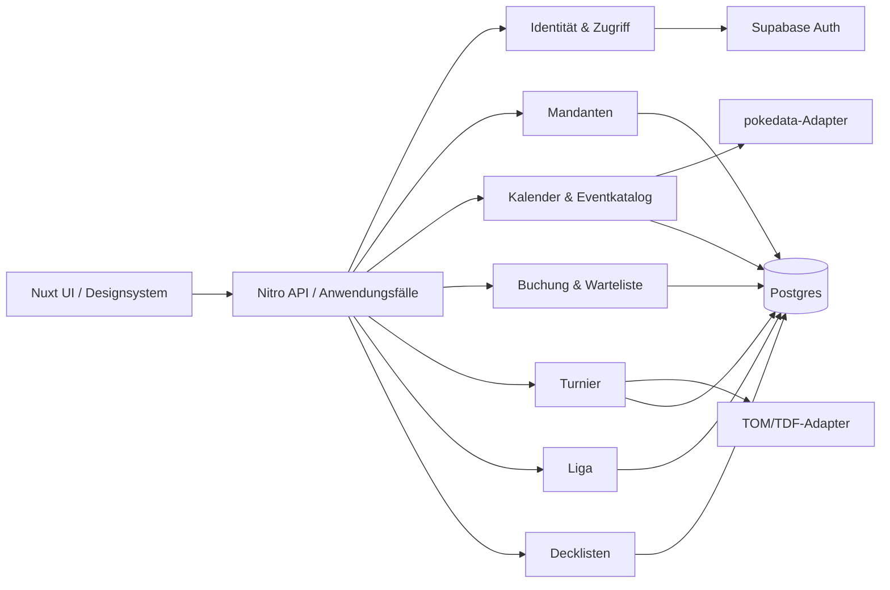

# Chrispyjams: Ist-Architektur und Vorschlag zur Modularisierung

Stand: 30. Oktober 2026. **Arbeitsdokument** auf Branch `codex/chrispyjams-architecture-rework`. Grundlage: statische Sichtung des Repositories und der Ideen in [`hot-features.md`](../hot-features.md). Umsetzung, Funktionsinventar und Prüftore stehen im [Implementierungsplan](architecture/IMPLEMENTATION_PLAN.md); Modulverträge und Dokumentationsstand im [Modulindex](architecture/MODULES.md). Entscheidungen und Prüfergebnisse werden im Verlauf ergänzt. Der Ist-Befund unten beschreibt den Ausgangszustand; produktive Prüfergebnisse sind datiert im Implementierungsplan festgehalten.

**Fortschritt:** P0 hat die Bye-/Score-Freigabe vereinheitlicht, wiederholbare Ergebnismeldungen mit Request-ID ergänzt, neue Diagnoseeinträge auf sichere Felder begrenzt und die League-Modelle im Prisma-Schema wiederhergestellt. Die Spielerantwort gibt keine unveröffentlichten TOM-Runden oder Geburtsdaten mehr zurück. Die additive Mandantenmigration ist auf Dev und Produktion angewandt, die zentrale Rollenprüfung vorbereitet; ein zweiter Laden ist bis zur vollständigen Scope-Prüfung nicht freigegeben. Die Befundtabelle unten beschreibt den **vorgefundenen Ausgangszustand**; der aktuelle Umsetzungsstand steht im Implementierungsplan.

## Kurzentscheidung

Chrispyjams erhält **klar abgegrenzte Fachmodule mit zwei Betriebsarten**: gemeinsam in einer Anwendung und, wo sinnvoll, als eigenständig deployte Dienste. Die Modulverträge sollen beide Aufrufarten unterstützen. Die Umstellung beginnt im gemeinsamen Deployment, damit Buchung, Warteliste, Turnierfreigabe und Decklistenstatus ohne zusätzliche Netzwerkrisiken entkoppelt werden können. Getrennte Deployments werden erst nach Vertrags-, Datenhoheits- und Integrationstests aktiviert; die Architektur darf sie dann nicht durch private Tabellenzugriffe oder interne Imports verhindern.

Der erste strukturelle Schritt ist **Mandant ≠ Veranstaltungsort ≠ Eventquelle**. „Lokale Events“ meint heute in der Praxis eigene Events von Crows & Owls. Ein weiterer Laden wäre ein zweiter Mandant mit eigenen Events, Orten, Personal, Berechtigungen und Einstellungen. Ein extern importiertes Event bleibt eine Eventquelle; es wird nicht allein durch den Standort zum Mandanten-Event.

## Ist-Bild

```mermaid
flowchart LR
  Browser[Nuxt UI] --> API[Nitro API-Routen]
  API --> Services[Teilweise ausgelagerte Services]
  Services --> DB[(Postgres / Prisma)]
  API --> DB
  API --> Supabase[Supabase Auth]
  API --> Pokedata[pokedata.ovh]
  Calendar[Kalender-UI] --> External[/api/events/detailed]
  Calendar --> Local[/api/events/custom]
  External --> Pokedata
  Local --> DB
  Tournament[Turnier-UI] --> TOM[TOM-Bridge API / XML-Zustand]
  TOM --> DB
```

| Bereich | Was tatsächlich existiert | Hauptbelege |
| --- | --- | --- |
| Laufzeit | Nuxt 3 mit Nitro-API, Prisma/Postgres und Supabase Auth in einer Anwendung. | [`package.json`](../package.json), [`nuxt.config.ts`](../nuxt.config.ts), [`lib/prisma.ts`](../lib/prisma.ts) |
| Kalender | Externe Pokémon-Events von pokedata.ovh mit serverseitigem Cache und Admin-Overrides; eigene Events aus `CustomEvent`. Der Browser lädt beide Feeds und vereinheitlicht sie für die Ansicht. | [`server/services/events/pokedataService.ts`](../server/services/events/pokedataService.ts), [`server/api/events.ts`](../server/api/events.ts), [`server/api/events/custom.get.ts`](../server/api/events/custom.get.ts), [`components/landingPageCards/calendar/EventCalendarCard.vue`](../components/landingPageCards/calendar/EventCalendarCard.vue), [`utils/calendarEventUtils.ts`](../utils/calendarEventUtils.ts) |
| Eventverwaltung | Admins legen eigene Events, Vorlagen und Orte an und pflegen externe Overrides. Die öffentliche Registrierung kann sowohl zu einem eigenen Event als auch zu einem externen Event mit lokal aktivierter Buchung gehören. | [`server/services/admin/eventAdminService.ts`](../server/services/admin/eventAdminService.ts), [`server/services/admin/externalEventAdminService.ts`](../server/services/admin/externalEventAdminService.ts), [`server/api/events/[id]/register.post.ts`](../server/api/events/%5Bid%5D/register.post.ts), [`prisma/schema.prisma`](../prisma/schema.prisma) |
| Buchung/Warteliste | `EventRegistration` gehört einem buchenden `Player`; darunter liegen mehrere `RegistrationTicket`. Kapazität, Platz und Nachrücken werden teils transaktional geprüft. | [`prisma/schema.prisma`](../prisma/schema.prisma), [`server/api/events/[id]/register.post.ts`](../server/api/events/%5Bid%5D/register.post.ts), [`server/services/events/waitlistService.ts`](../server/services/events/waitlistService.ts) |
| Turnier | TOM/TDF-Import und -Export, Freigabe, Pairings, Meldungen, Konfliktauflösung und Spieleransicht. `TournamentTomState` hängt 1:1 an `CustomEvent`; XML und viele Zustandsdetails liegen im Datensatz bzw. in `metadata` JSON. Live-Updates nutzen Server-Sent Events plus Polling. | [`server/services/events/tournamentTomStateService.ts`](../server/services/events/tournamentTomStateService.ts), [`server/services/events/tomTdfService.ts`](../server/services/events/tomTdfService.ts), [`pages/tournaments/[eventId].vue`](../pages/tournaments/%5BeventId%5D.vue) |
| Identität/Rechte | Supabase authentifiziert Endnutzer; der Server löst sie zentral über `authService` auf. Admin-Rolle kommt aus verifizierten `app_metadata`; API-Zugriff wird serverseitig geprüft. `Player` ist das lokale Fachprofil. | [`server/services/auth/authService.ts`](../server/services/auth/authService.ts), [`server/util/adminAccess.ts`](../server/util/adminAccess.ts), [`server/util/authenticatedPlayer.ts`](../server/util/authenticatedPlayer.ts), [`services/authSessionService.ts`](../services/authSessionService.ts) |
| Decklisten | `requiresDecklist` liegt auf Event/Override. Der Text und „vor Ort mitbringen“ liegen pro Ticket; Speichern erfolgt über Buchungs-/Dashboard-Routen. Es gibt Validator, Kartenrepository und Importer, aber keinen abgeschlossenen eigenständigen Decklisten-Lebenszyklus. | [`server/api/dashboard/decklist.put.ts`](../server/api/dashboard/decklist.put.ts), [`server/api/validate.post.ts`](../server/api/validate.post.ts), [`server/util/PTCGValidator.ts`](../server/util/PTCGValidator.ts), [`components/DecklistImporter.vue`](../components/DecklistImporter.vue) |
| Liga | Zusätzlich zur Hot-Features-Liste gibt es einen League Manager mit Saison, Wertung und TDF-Import. Dieser Bereich muss im Schnittbild berücksichtigt werden. | [`server/services/league/leagueService.ts`](../server/services/league/leagueService.ts), [`prisma/migrations/20260829120000_add_league_manager/migration.sql`](../prisma/migrations/20260829120000_add_league_manager/migration.sql) |
| UI | Gemeinsame Bausteine (`AppPanel`, `AppModal`, `AppDataTable`, `AdminPageLayout`) und gemeinsame CSS/Design-Dokumentation sind vorhanden; größere Feature-Seiten tragen dennoch viel eigene Ansicht und Ablaufsteuerung. | [`components/AdminPageLayout.vue`](../components/AdminPageLayout.vue), [`components/AdminEventsManager.vue`](../components/AdminEventsManager.vue), [`pages/admin/tournament-management.vue`](../pages/admin/tournament-management.vue), [`aidocs/DESIGN_SYSTEM.md`](DESIGN_SYSTEM.md) |

### Fachliche Datenbeziehungen heute



`VenueDirectoryEntry` speichert lediglich Organisations- und Ortsnamen; es ist kein Mandant und keine Berechtigungsgrenze. `EventRegistration` und `WaitlistEntry` haben jeweils optionale Fremdschlüssel für eigene und externe Events. Diese Polymorphie wird im Anwendungscode aufgelöst; das Schema erzwingt nicht sichtbar „genau eine Event-Art“.

## Was bereits sauber ist

1. **Authentifizierungsautorität ist benannt.** Clientseitige Session-Verwaltung liegt in `services/authSessionService.ts`, serverseitige Endnutzer-Identität in `server/services/auth/authService.ts`. Die Service-Role-Key-Konfiguration ist serverseitig in `nuxt.config.ts` abgelegt. Diese Grenzen müssen bei der Modularisierung erhalten bleiben.
2. **Admin-Zugriff wird serverseitig geprüft.** `defineAdminRoute` und `verifyAdmin` bilden eine wiederverwendbare Hülle; die Rolle wird aus serverseitig verifizierter Supabase-Identität gelesen.
3. **Externe Quelle und eigene Events sind erkennbar getrennt.** pokedata-Adapter, Overrides und `CustomEvent` sind unterschiedliche Konzepte. `eventProjectionService` und `calendarEventUtils` beginnen, daraus Ansichtsmodelle zu formen.
4. **Mehrteilnehmer-Buchung hat ein brauchbares Modell.** Ein Bucher und mehrere Tickets passen zum tatsächlichen Anwendungsfall; Kapazitätsprüfung und Wartelistenbewegungen nutzen an kritischen Stellen Transaktionen.
5. **Turnier ist bereits eine fachliche Einheit.** TOM/TDF-Parser, Zustandsservice, Endpunkte für Admin und Spieler sowie Freigabezustände sind vorhanden. Die Spieler-Endpunkte kontrollieren Registrierung bzw. Gastzugang auf dem Server.
6. **UI-Grundbausteine existieren.** Das ist eine sinnvolle Basis für die gewünschte konsistente Oberfläche, ohne ein neues UI-Framework einzuführen.

## Wo es „wischiwaschi“ ist

| Priorität | Unschärfe und konkrete Folge | Beleg |
| --- | --- | --- |
| Hoch | **Kein Mandantenschlüssel.** `CustomEvent`, `EventTemplate`, `ExternalEventOverride`, `VenueDirectoryEntry` und Turnierzustand haben kein `tenantId`. Eine globale Admin-Rolle kann damit nicht als Laden-Rolle dienen; Listen und Mutationen sind nicht mandantenbezogen. `venue` ist Freitext, `createdBy` bezeichnet einen Nutzer, keinen Betreiber. | [`prisma/schema.prisma`](../prisma/schema.prisma), [`server/services/admin/eventAdminService.ts`](../server/services/admin/eventAdminService.ts), [`server/util/adminAccess.ts`](../server/util/adminAccess.ts) |
| Hoch | **Crows-&-Owls-Regel im allgemeinen Feed.** Externe Events dieses Ortes werden über hartcodierten Namen und Adresse standardmäßig ausgeblendet. Mit einem zweiten Laden wäre das keine generische Deduplizierung oder Mandantenregel. | [`utils/externalEventVisibility.ts`](../utils/externalEventVisibility.ts) |
| Hoch | **Turniermeldung ist bei Netzfehler nicht nachweisbar angekommen.** Der Client sendet einmal per POST und lädt danach neu. Es gibt keinen stabilen Request-Schlüssel, kein definiertes Wiederholprotokoll und keine explizite Empfangsbestätigung im UI. Serverseitig ersetzen Meldungen für dasselbe Pairing offene Einträge; bei parallelen Änderungen erfolgt ein Lesen/Schreiben des gesamten JSON-/XML-Zustands ohne sichtbare Versionsbedingung. Eine verlorene Antwort kann daher nicht sicher von einer verlorenen Meldung unterschieden werden. | [`pages/tournaments/[eventId].vue`](../pages/tournaments/%5BeventId%5D.vue), [`server/services/events/tournamentTomStateService.ts`](../server/services/events/tournamentTomStateService.ts) |
| Hoch | **Freigabe und Anzeige sind nicht überall dieselbe Regel.** Der Service filtert unveröffentlichte *offene* Pairings aus der Historie, zählt aber abgeschlossene Matches bereits im Score und lässt sie in der Historie zu. Ein Bye wird als Sieg dargestellt. Damit ist der bekannte Bye-vor-Freigabe-Bug aus `hot-features.md` aus dem Code plausibel erklärbar; ein Reproduktionstest fehlt in dieser Sichtung. | [`server/services/events/tournamentTomStateService.ts`](../server/services/events/tournamentTomStateService.ts), [`pages/tournaments/[eventId].vue`](../pages/tournaments/%5BeventId%5D.vue), [`hot-features.md`](../hot-features.md) |
| Mittel | **Kalender-Komposition verteilt sich über Server und Client.** Externe und eigene Events kommen aus zwei APIs; der Browser führt sie zusammen. `/api/events/detailed` ruft `/api/events` auf und wendet Overrides nochmals an. Dazu kommen 18-Stunden-Servercache und 5-Minuten-Clientcache; Änderungen und Sichtbarkeit haben damit keinen einzigen Aktualisierungspunkt. | [`server/api/events.ts`](../server/api/events.ts), [`server/api/events/detailed.ts`](../server/api/events/detailed.ts), [`composables/useEventStore.ts`](../composables/useEventStore.ts), [`components/landingPageCards/calendar/EventCalendarCard.vue`](../components/landingPageCards/calendar/EventCalendarCard.vue) |
| Mittel | **Decklisten sind Ticket-Felder statt eigener Fachzustand.** Validierung, Einreichung, Bearbeitungsfrist, Veranstalterzugriff und Buchungsstatus liegen an verschiedenen Stellen. `decklist.put.ts` setzt den Ticketstatus anhand der Deckliste. Das koppelt Teilnahme und Decklistenprüfung. Der Validator schreibt zudem Token in `./debug/data/decktokens.json`, und der Validate-Endpunkt gibt die eingereichte Deckliste per `console.info` aus; beides vor Inbetriebnahme entfernen. | [`prisma/schema.prisma`](../prisma/schema.prisma), [`server/api/dashboard/decklist.put.ts`](../server/api/dashboard/decklist.put.ts), [`server/api/validate.post.ts`](../server/api/validate.post.ts), [`server/util/PTCGValidator.ts`](../server/util/PTCGValidator.ts) |
| Mittel | **Fehlerdiagnostik ist nicht auf sichere Felder begrenzt.** `ErrorLog` enthält noch eine `cookies`-Spalte; der Logger speichert komplette URL, Query, Fehlermeldung und Stack ohne Redaktionsschicht. Das ist mit der Auth-Vorgabe „keine Cookies, Header, Tokens oder Secrets in Logs“ nur dann sicher, wenn alle Aufrufer garantiert nie solche Werte liefern. Diese Garantie ist im Logger nicht eingebaut. | [`prisma/schema.prisma`](../prisma/schema.prisma), [`server/util/errorLogger.ts`](../server/util/errorLogger.ts) |
| Mittel | **Schema-Drift beim League Manager.** Die SQL-Migration erstellt mehrere `league_*`-Tabellen und der Service nutzt `prisma.leagueSeason` usw.; in der eingecheckten `schema.prisma` fehlen die entsprechenden Modelle. Das ist ein konkreter Generierungs-/Deploy-Risikopunkt, der vor größerem Umbau geklärt werden muss. | [`prisma/migrations/20260829120000_add_league_manager/migration.sql`](../prisma/migrations/20260829120000_add_league_manager/migration.sql), [`server/services/league/leagueService.ts`](../server/services/league/leagueService.ts), [`prisma/schema.prisma`](../prisma/schema.prisma) |
| Niedrig bis mittel | **Ortsverzeichnis pflegt seine Tabelle zusätzlich zur Migration zur Laufzeit** (`CREATE TABLE IF NOT EXISTS` in einem Service). Damit liegen Schema-Verantwortung und Deployment-Verantwortung an zwei Stellen. | [`server/services/admin/venueAdminService.ts`](../server/services/admin/venueAdminService.ts), [`prisma/migrations/20260501120000_add_venue_directory_entries/migration.sql`](../prisma/migrations/20260501120000_add_venue_directory_entries/migration.sql) |

## Zielbild: fachliche Module, gemeinsamer oder getrennter Betrieb



| Modul | Besitzt | Darf von anderen Modulen bezogen werden |
| --- | --- | --- |
| Identität & Zugriff | Auth-Auflösung, `Player`-Zuordnung, globale Plattformrollen und mandantenbezogene Mitgliedschaften. | `ActorContext` mit verifizierter User-ID und serverseitig bestimmten Rechten; keine clientseitige Rollenautorität. Bestehende `authSessionService.ts` und `authService.ts` bleiben die einzigen Session-/Identitätsautoritäten. |
| Mandanten | `Tenant`, `TenantMembership`, Betreiberprofil, `Venue`, tenantbezogene Einstellungen/Branding. | `requireTenantRole(actor, tenantId, action)` und aufgelöster `TenantContext`. Ein Laden ist Mandant; ein Laden kann mehrere Orte haben. |
| Kalender & Eventkatalog | Publikation, Zeit/Ort, Sichtbarkeit, Quellenzuordnung, externer Import, Vorlagen und eine einheitliche Leseprojektion. | Stabile `eventId`, `tenantId` bei eigenen Events, `source` (`owned`/`external`), `registrationMode`, `capabilities`. Kalender bedeutet **Entdecken**, nicht automatisch Turnier oder Buchung. |
| Buchung & Warteliste | Buchungen, Tickets, Kapazität, Nachrücken, Stornierung. | `registrationId`, `ticketId`, Teilnehmer- und Statusereignisse; nur dieses Modul ändert Teilnahme-/Reservierungsstatus. |
| Turnier | Turnierinstanz, TOM-Snapshots, Rundenfreigabe, Pairings, Ergebnismeldungen und Turnierplatzierungen. | Turnier-Zustandsabfragen und fachliche Befehle wie `releaseRound`, `reportResult`. Das Modul referenziert `eventId`, besitzt aber nicht den Kalenderdatensatz. |
| Liga | Saisons, Punkteregeln, Ligaspieler, Teilnahme, Importe und Tabellen. | Versionierte Turnierresultate bzw. Importdateien; keine direkten Lesezugriffe auf private Turniertabellen. |
| Decklisten | Einreichung je Ticket, Format, Version, Prüfstatus, Frist und Zugriffsrechte; Karten-/Validatoradapter. | `DecklistStatus` und explizite Befehle `submit`, `replace`, `validate`, `review`. Buchung fragt den Status ab, setzt ihn aber nicht selbst. |

### Mandantenmodell und konkretes Beispiel

Minimaler Datenkern: `Tenant(id, slug, name, status, settings)`, `TenantMembership(tenantId, userId, role)`, `Venue(id, tenantId, name, address)`. `CustomEvent`, `EventTemplate`, `ExternalEventOverride`, `TournamentTomState` und perspektivisch `LeagueSeason` erhalten eine eindeutige Mandantenzuordnung. Buchung/Ticket/Deckliste können den Mandanten über ihr Event ableiten, sollten für sichere Queries und Audit bei Bedarf zusätzlich einen unveränderlichen `tenantId` tragen. Einen externen Feed-Eintrag kann ein Mandant **claimen** oder mit einer eigenen Eventinstanz verknüpfen; er wird nicht durch Namensgleichheit zu dessen Eigentum.

Beispiel: `tenant.slug = crows-and-owls` hat den Ort „Crows & Owls“ und seine eigenen Events. `tenant.slug = anderer-laden` hat eigene Orte und Events. Beide dürfen denselben öffentlichen pokedata-Feed sehen; ihre Admins dürfen ausschließlich ihre eigenen Events, Buchungen, Turniere und Decklisten verwalten. Ein Plattformadmin darf mandantenübergreifend arbeiten, aber nur über eine ausdrücklich getrennte Rolle. Crows-&-Owls-Deduplizierung wird als **tenantbezogene Quellenverknüpfung** modelliert, nicht als globale Namen-/Adressregel.

**Sicherheitsinvariante:** Jeder schreibende API-Aufruf löst den Actor serverseitig auf, ermittelt den Tenant aus dem adressierten Objekt und prüft Mitgliedschaft plus Recht **vor** der Mutation. Ein `tenantId` im Request ist höchstens ein Suchhinweis, nie ein Berechtigungsbeweis. Queries für mandantengebundene Listen und Einzelobjekte filtern serverseitig nach `tenantId`; Cross-Tenant-Zugriffe liefern keinen fremden Datensatz. Für Migrationsphase und Hintergrundjobs sind explizite System-/Plattformkontexte nötig. Service-Role-Key bleibt ausschließlich serverseitig und nur für administrative Supabase-Operationen.

### Ein Eventbegriff für alle Oberflächen

Die Kalender-Leseprojektion sollte serverseitig aus eigenen Events und externen Quellen erstellt werden. Intern bleiben Quelle und Eigentümerschaft getrennt. Vorschlag für die öffentliche Projektion: `{ id, source, tenantId?, title, startsAt, timeZone, venue, visibility, registrationMode, capabilities, tournamentStatus? }`. Identitäten externer Events brauchen stabile Provider-IDs; Overrides sollten an Provider-ID plus Provider hängen statt primär an Name und Datum. Ein externer Eintrag mit lokaler Buchung wird als explizite Verknüpfung behandelt. Das vermeidet doppelte Buchungswege und erlaubt nachvollziehbare Deduplizierung pro Mandant.

### Turnier und Deckliste entkoppeln

`Event` ist die Veröffentlichung; `Tournament` ist eine optionale Durchführung. Eine Buchung ist Teilnahmeabsicht, ein TOM-Spieler eine Turnieridentität. Die Abbildung muss explizit sein (`ticketId`/`playerId` ↔ TOM-ID), nicht allein aus einem Freitext-Player-ID-Feld erschlossen werden. TOM-XML bleibt zunächst Import-/Exportformat. Freigaben, Meldungen und Versionen sollten als strukturierte, transaktional änderbare Datensätze geführt werden; XML kann daraus materialisiert werden. Für Decklisten gilt analog: je Ticket ein separater Einreichungszustand mit Version und Validierungsergebnis. Ob „vor Ort“ zulässig ist, ist eine Eventregel; es ist keine Deckliste.

## Reihenfolge der Umsetzung

1. **Sofortige Korrekturen vor Umbau:** Decklisten aus Log und Debug-Datei entfernen; Logger auf redigierte, erlaubte Felder begrenzen. Bye-/Score-Sichtbarkeit an dieselbe Rundenfreigabe koppeln und einen Regressionstest dafür ergänzen. Ergebnismeldungen mit Request-ID, persistenter Quittung und Wiederholbarkeit absichern; Client zeigt `sendet`/`bestätigt`/`unklar` und fragt bei unklarer Antwort den Serverzustand ab. Keine bloß optimistische Siegesanzeige als Empfangsnachweis.
2. **Verträge festziehen:** Ein fachliches `EventSummary` und `EventRef`, ein `ActorContext`, explizite Status-/Befehlstypen und klare Modul-APIs. Bestehende Routen können als Fassade bleiben. League-Prisma-Schema gegen Migration und generierten Client abgleichen.
3. **Mandanten einführen:** Seed für Crows & Owls; Memberships und Tenant-Guard; `tenantId` an eigene Events, Vorlagen, Orte und externe Verknüpfungen; bestehende Datensätze migrieren. Die erste additive Migration verwendet für die belegte Ein-Laden-Datenbank `NOT NULL` mit Crows-&-Owls-Default. Dieser Default schützt bestehende Schreibpfade während der Umstellung, darf aber vor einem zweiten Mandanten nicht als Zuordnungsregel dienen. Danach alle Neuanlagen ausdrücklich aus geprüftem Tenant-Kontext zuordnen, globale Eindeutigkeiten migrieren und sämtliche Listen/Mutationen mit Cross-Tenant-API-Tests absichern. Erst dann einen zweiten Laden freischalten.
4. **Kalender vereinheitlichen:** Serverseitige Leseprojektion für lokale und externe Events, konfigurierbare Feed-Quellen, tenantbezogene Deduplizierung und gezielte Cache-Invalidierung bei Event-/Override-Änderung. Öffentliche Ansicht kann weiterhin tenantübergreifend sein; Betreiberansichten erhalten einen klaren Tenant-Scope.
5. **Turnier, Liga und Decklisten herauslösen:** Erst fachlich im gemeinsamen Deployment, mit eigenen Tabellen/Repositories und Schnittstellen. Danach werden die Transportadapter und separaten Deployments anhand der dokumentierten Kriterien und Paritätstests aktiviert.
6. **UI konsolidieren:** Gemeinsame Eventkarte, Statusanzeige, Formelemente und Adminseiten-Shell aus den vorhandenen `App*`-Komponenten ableiten; Event-, Buchungs-, Turnier- und Decklistenstatus einheitlich benennen. UI-Arbeit folgt den stabilen Fachbegriffen, damit dieselbe Aktion überall dasselbe bedeutet.

**Wann getrennt deployen?** Die technische Möglichkeit ist Zielvorgabe; die Aktivierung erfolgt pro Modul, wenn dessen Datenhoheit, Netzfehlerverhalten, Authentifizierung und Betriebsbeobachtung nachweislich funktionieren. Ein Modul muss unabhängig skalierbar und versionierbar sein, ohne private Tabellen anderer Module zu lesen. Der TOM-Adapter oder die externe Feed-Integration sind frühe Kandidaten für isolierte Worker; die bestehende Auth-Autorität bleibt erhalten.

## Offene Produktentscheidungen

- Ist der öffentliche Kalender ein gemeinsamer Chrispyjams-Kalender mit Mandantenfilter, oder bekommt jeder Laden zusätzlich eine eigene Domain/Startseite? Das beeinflusst URL-Schema und Branding, nicht die Pflicht zur serverseitigen Tenant-Prüfung.
- Dürfen externe Events von mehreren Mandanten separat „beansprucht“ werden, und wer ist dann für Buchung und Änderungen zuständig?
- Soll ein Event mehrere Turniere oder Spielformate enthalten können? Das bestimmt `Event`–`Tournament` als 1:n oder 1:1.
- Welche Decklistenformate und Prüfregeln gehören zur ersten Inbetriebnahme, und wer darf eine eingereichte Liste ab wann sehen?

## Prüfumfang

Die Aussagen zum Ausgangszustand beruhen auf den genannten Dateien, Prisma-Schema und Migrationen. „Bye vor Freigabe“ wurde inzwischen als Regressionstest ergänzt und der Pfad korrigiert. Die additive Mandantenmigration wurde am 30. Oktober 2026 auf Produktion ausgeführt; 51/51 eigene Events sind gültig zugeordnet. Ein echter Browser-Durchlauf mit gültigen TOM-Gastdaten und die vollständige Tenant-Isolation stehen noch aus. Implementierte Änderungen und verbleibende Risiken stehen im Implementierungsplan.

**Analytics-Nachtrag, 27. Oktober 2026:** Die Adminauswertung unterscheidet aktive Besucher, Startseitenkalender-Klicks, erfolgreiche Logins und Aufrufe von Dashboard und Eventliste. Der Analytics-Service besitzt die Ereignistypen und Aggregation; die Login- und Kalenderoberflächen senden nur klar benannte Ereignisse über den zentralen Client-Helper. Das gemeinsame Deployment verwendet weiterhin Nitro und Postgres. Für einen separaten Analytics-Betrieb wäre die Trackingroute durch einen versionierten Transportvertrag zu ersetzen, einschließlich Ausfallverhalten und späterem Tenant-Scope. Die additive Dev-Migration `20261027150000_add_analytics_key_interactions` ist angewendet; ältere Klick- und Loginzahlen sind nicht nachträglich ableitbar.

**Turnierzugang-Nachtrag, 30. Oktober 2026:** Der QR-Kurzlink ist öffentlich; Gastspieler identifizieren sich nach Turnierfreigabe mit TOM-Spieler-ID und vollständigem Geburtsdatum. Bei angemeldetem Profil genügt passende TOM-ID plus Geburtsjahr für die automatische Zuordnung. Spieleransicht, Ergebnismeldung und SSE nutzen eine gemeinsame serverseitige Identitätsauflösung. Der Gastzugang ist ein signiertes, eventgebundenes HttpOnly-Cookie; ein Chrispyjams-Konto ist für diesen Weg nicht erforderlich. Vor Multi-Instanz-Betrieb fehlt eine verteilte Versuchsdrosselung am öffentlichen Prüfpunkt.

**Korrektur des QR-Vertrags, 30. Oktober 2026:** Die Anforderung lautete Spieler-ID plus Geburtsjahr. Der erste Gastpfad verlangte versehentlich den vollständigen Geburtstag, während angemeldete Spieler bereits über das Jahr abgeglichen wurden. Beide Pfade verwenden nun die zentrale TOM-Jahresprüfung; die vollständige Datumsform bleibt nur als Übergangskompatibilität für bereits geöffnete Tabs. Kein Konto und keine Eventregistrierung sind für den QR-Gastpfad erforderlich.

**Turniersteuerung, 31. Oktober 2026:** Zuvor öffnete „Turnier starten“ nur `/admin/tournament-management?eventId=…`; die Steuerungsseite zeigte keine Eventliste und bezog die zuletzt gewählte ID aus URL oder gerätelokalem Speicher. Die neue persistente `TournamentManagementSession` markiert das erste Öffnen idempotent. Eine Admin-Projektion zeigt sämtliche markierten Turniere und ältere TOM-Importe gruppiert nach laufend/beendet. Der direkte URL-Einstieg und die bestehenden `tom-bridge`-Routen bleiben erhalten. Im gemeinsamen Betrieb liest die Projektion Eventdetails noch direkt; vor separatem Deployment ist ein Event-Projektionsport samt Tenant-Scope nötig.

**Eventdarstellung, 27. Oktober 2026:** Öffentliche Eventkarten verwenden nun eine gemeinsame Wasserzeichen-Komponente für TCG, VGC und GO. Die SVG-Varianten und responsiven Theme-Regeln sind zentral in `components/events/` und `assets/css/event-game-watermark.css` gehalten. Spieltyp bleibt ein Feld der Eventprojektion; die Darstellung leitet keine eigene Fachzuordnung aus einem CSS-Namen ab. Andere Spiele erhalten kein Pokémon-Logo. Die Komponentengrenze und ihre Abhängigkeiten stehen in `components/events/README.md`.

**Registrierungsdruck, 30. Oktober 2026:** Die Admin-Registrierungsliste erhält einen Browser-PDF-Export im DIN-A4-Format. Ein Ticket entspricht einer Druckzeile; die Bucher-E-Mail steht als Kontakt unter dem Teilnehmernamen. Das Geburtsjahr wird nach Möglichkeit über die Teilnehmer-Spieler-ID gelesen und nicht pauschal vom Bucher übernommen. Die bestehende Admin-Leseroute bleibt erhalten und wird vor dem Export aktualisiert. Der PDF-Adapter besitzt keine Buchungsdaten; ein später separat betriebener Buchungsdienst muss denselben geschützten Lesevertrag liefern. Vor Freigabe weiterer Mandanten bleibt die Tenant-Prüfung des Admin-Lesewegs ein offenes Tor.

**Admin-Eventkarten, 31. Oktober 2026:** Bisher enthielten Karten in `/admin/events` nur eine Kurzfassung; ein Klick öffnete ein Details-Modal mit Status, Tags, Datum, Ort, Belegung, Gebühr, Decklistenpflicht, Beschreibung und Aktionen. Die Karten stellen diese Angaben und Aktionen nun selbst dar. Die Registrierungs-URL erscheint als Kopier-Icon ohne sichtbares URL-Feld. Die bestehenden Admin-Datenverträge und Verwaltungsdialoge bleiben erhalten; die UI nutzt eine gemeinsame Kartenkomponente für kommende und beendete Events.

**Seitentitel und Dev-Vorschau, 31. Oktober 2026:** Die bisherige globale Browser-Titelvorgabe „PTCG Event Manager“ erschien auf Seiten ohne eigene `useHead`-Angabe, auch in der Turniersteuerung. `AdminPageLayout` setzt nun den Tab-Titel aus der sichtbaren Seitenüberschrift; das Standardlayout liefert pfadbezogene Fallbacks für öffentliche Seiten. Die bestehende Dev-Designvorschau zeigt die neuen Eventkarten mit erfundenen Daten, ohne Admin-API oder Datenbank. Echte Eventdaten und Authentisierung sind davon unberührt.
